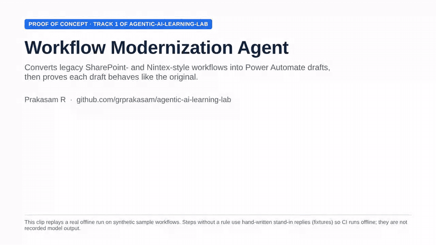
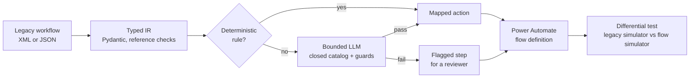
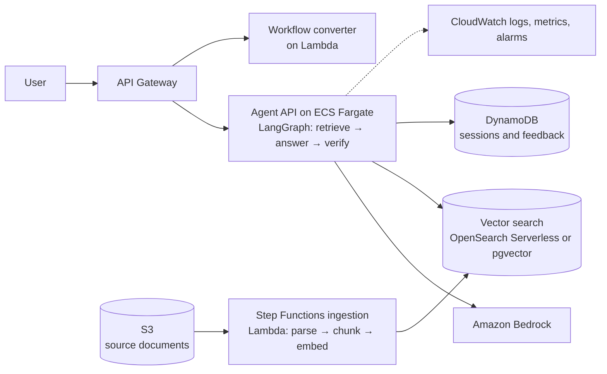

# agentic-ai-learning-lab

[](https://github.com/grprakasam/agentic-ai-learning-lab/actions/workflows/workflow-modernization.yml)

**My hands-on agentic AI learning lab, in two tracks:**

1. **Workflow modernization (built and tested offline).** Converts legacy XML/JSON workflows into Power Automate drafts: deterministic rules first, a bounded LLM second, everything else flagged, and differential testing to check that each draft behaves like the original.
2. **Regulatory RAG on AWS (learning: design done in October 2026, build planned from November 2026).** Retrieval evaluation, permission-aware search, an answer-and-verify flow, and deployment on AWS with Terraform.

**What is and isn't proven.** Status labels below show what is built. Track 1 runs on 12 synthetic sample workflows and has not been imported into a live Power Platform tenant. Anything marked *Planned* has not been built yet. Nothing in this repository is production experience.

My other public work: [ADAM AI](https://github.com/grprakasam/adam-ai) and [AI Exam Builder](https://github.com/grprakasam/Ai_ExamBuilder_Jan26).

## Demo



A one-minute replay of a real offline run. The KYC review sample converts 6 actions by rule and 1 through the bounded LLM, and flags 1 step that has no catalog equivalent; the two test cases that differ both trace to that flagged step, so there are no silent failures. Steps without a rule use hand-written fixture replies, not a live model. [MP4 version](docs/demo/workflow-modernization-demo.mp4).

## Track 1: Workflow modernization (built)

Microsoft retired SharePoint 2013 workflows in SharePoint Online in April 2026 and recommends Power Automate instead. Rebuilding every flow by hand is slow; translating with an LLM alone is fast but unverifiable. This track takes a middle path:



| Result on 12 synthetic workflows, 29 behavioral tests | Rules only | Rules + bounded LLM (fixture replies) |
|---|---|---|
| Actions converted automatically | 53 of 65 (82%) | 62 of 65 (95%) |
| Behavioral test cases passed | 14 of 29 | 24 of 29 |
| **Silent failures** (a case fails but nothing was flagged) | **0** | **0** |

The fixture replies are hand-written stand-ins so CI runs offline; they are not recorded model output. CI fails if silent failures ever rise above zero. Full details, guardrails and decision records: [workflow_modernization/README.md](workflow_modernization/README.md).

```bash
cd workflow_modernization
pip install -e ".[dev]"
pytest -q
python -m wma evaluate          # writes results/latest_scorecard.md
```

**Next for this track (planned):** a recorded live-model run; an adapter for real SharePoint 2013 and Nintex exports; an import test in a Power Platform developer environment comparing run history with the legacy cases; and the converter deployed as an AWS Lambda behind API Gateway, which ties it to Track 2.

## Track 2: Regulatory RAG on AWS (design done; build planned)

A question-answering assistant over **public-domain FDA guidance documents**:

1. **Retrieval with measured quality**: a labelled question set and retrieval metrics, used to compare chunking and search choices.
2. **Permission-aware search**: documents carry access labels, and tests prove one user group cannot retrieve another group's documents.
3. **Multi-agent answer-and-verify flow**: a retriever, an answerer and a verifier that checks every claim against the retrieved text, abstaining when evidence is missing.
4. **Deployed on AWS with Terraform**: infrastructure as code, least-privilege access, monitoring and a cost budget, torn down when not in use.
5. **Azure comparison**: the same evaluation run against Azure OpenAI through Microsoft Foundry.



Terraform manages every resource. Each service gets its own IAM role with least privilege, and keys live in Secrets Manager. Choices with real trade-offs, such as OpenSearch Serverless versus pgvector on RDS (cost floor versus operational effort), will be recorded as decision records in `docs/adr/`.

## Skills map

| Skill | Track | Status |
|---|---|---|
| Typed intermediate representation and XML/JSON parsing (Pydantic) | 1 | Done |
| Bounded LLM mapping with guardrails (closed catalog, schema, grounding and confidence checks) | 1 | Done |
| Differential behavioral testing and a silent-failure CI gate | 1 | Done |
| Power Platform solution preparation with PAC CLI (tests mock PAC) | 1 | Done |
| Live-model run, real export adapter, live tenant import test | 1 | Planned |
| RAG evaluation (recall@k, MRR, faithfulness, abstention rate) | 2 | Planned |
| Chunking and search strategies (BM25, dense, hybrid with reranking) | 2 | Planned |
| Vector search (pgvector, OpenSearch) | 2 | Planned |
| Permission-aware retrieval | 2 | Planned |
| Multi-agent orchestration (LangGraph) | 2 | Planned |
| Terraform | 1, 2 | Planned |
| AWS API Gateway, Lambda, Step Functions | 1, 2 | Planned |
| AWS ECS Fargate, S3, DynamoDB | 2 | Planned |
| AWS IAM, Secrets Manager, CloudWatch, Budgets | 1, 2 | Planned |
| Azure OpenAI, Microsoft Foundry | 2 | Planned |

## Milestones (targets, not promises)

| Milestone | Target | Status |
|---|---|---|
| M0. Repository and plan | Oct 2026 | Done |
| M1. Track 1 merged in: converter, tests, scorecard, CI | Oct 2026 | Done |
| M2. Local RAG baseline: ingestion, pgvector in Docker, evaluation harness | Nov 2026 | Planned |
| M3. Answer-and-verify flow; permission tests; live-model run for Track 1 | Dec 2026 | Planned |
| M4. AWS deployment with Terraform (RAG assistant and converter); monitoring and budget | Dec 2026 – Jan 2027 | Planned |
| M5. Azure comparison; Power Platform tenant import test; write-up | Jan 2027 | Planned |

I am also preparing for the AWS Certified Generative AI Developer – Professional exam alongside this work (target: Q1 2027).

## How results are reported

- Every number states what produced it: unit test, fixture or rules-only run, offline run or live cloud run.
- Failures and wrong answers are published alongside successes.
- Cloud costs are reported per run; resources are destroyed with `terraform destroy` after each session.

Progress notes: [LEARNING_LOG.md](LEARNING_LOG.md)

## Repository layout

```
workflow_modernization/   Track 1: converter, tests, samples, scorecard, decision records (MIT licence)
docs/adr/                 Track 2 decision records (planned)
LEARNING_LOG.md           Dated progress notes
```

## How this was built

I built this lab in October 2026. Track 1 started as a separate repository ([workflow-modernization-agent](https://github.com/grprakasam/workflow-modernization-agent), now archived) and was merged here with its history. Claude Code is my pair programmer: it drafts code and tests; I set the design (recorded in the decision records), review every change and decide what ships.

## Author

Prakasam R · [github.com/grprakasam](https://github.com/grprakasam) · [linkedin.com/in/grprakasam](https://www.linkedin.com/in/grprakasam)
