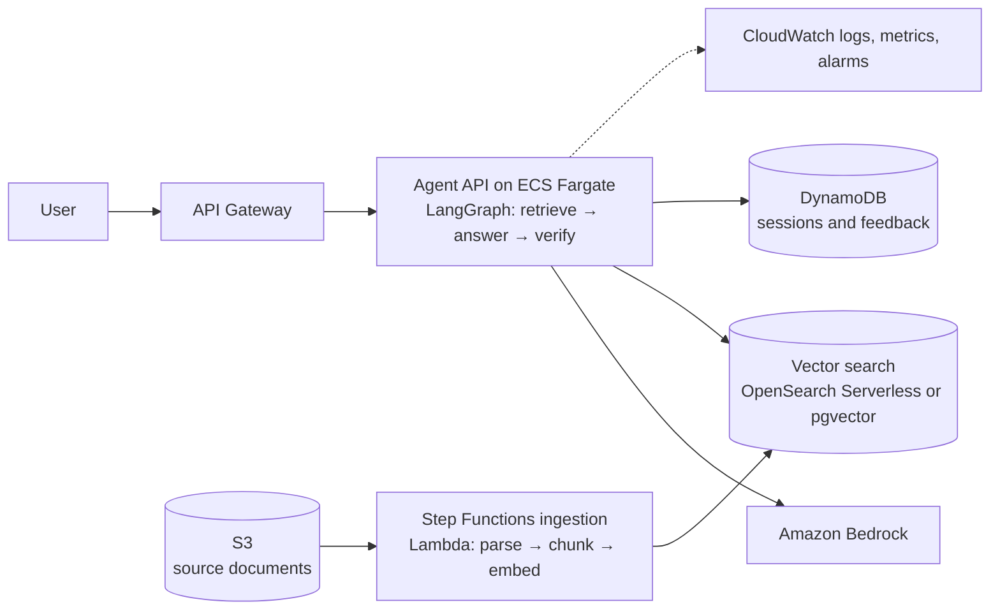

# my_ai_pet_project

**A learning project.** I started it in October 2026 to build hands-on skill in the cloud and retrieval topics I am still learning. The status column below shows what is done; anything marked *Planned* has not been built yet. Nothing in this repository is production experience.

My proven work is in [ADAM AI](https://github.com/grprakasam/adam-ai), the [Workflow Modernization Agent](https://github.com/grprakasam/workflow-modernization-agent) and [AI Exam Builder](https://github.com/grprakasam/Ai_ExamBuilder_Jan26). This repo is where I practise what comes next.

## What I am building

A question-answering assistant over **public-domain FDA guidance documents**:

1. **Retrieval with measured quality**: a labelled question set and retrieval metrics, used to compare chunking and search choices.
2. **Permission-aware search**: documents carry access labels, and tests prove one user group cannot retrieve another group's documents.
3. **Multi-agent answer-and-verify flow**: a retriever, an answerer and a verifier that checks every claim against the retrieved text, abstaining when evidence is missing.
4. **Deployed on AWS with Terraform**: infrastructure as code, least-privilege access, monitoring and a cost budget, torn down when not in use.
5. **Azure comparison**: the same evaluation run against Azure OpenAI through Microsoft Foundry.

## Target architecture (planned)

Terraform manages every resource. Each service gets its own IAM role with least privilege, and keys live in Secrets Manager. Choices with real trade-offs, such as OpenSearch Serverless versus pgvector on RDS (cost floor versus operational effort), will be recorded as decision records in `docs/adr/`.

## Skills map

| Skill I am learning | Where it is used here | Status |
|---|---|---|
| RAG evaluation (recall@k, MRR, faithfulness, abstention rate) | Evaluation harness and question set | Planned |
| Chunking and search strategies (BM25, dense, hybrid with reranking) | Retrieval experiments | Planned |
| Vector search (pgvector, OpenSearch) | Retrieval store | Planned |
| Permission-aware retrieval | Access-label filters and tests | Planned |
| Multi-agent orchestration (LangGraph) | Answer-and-verify flow | Planned |
| Terraform | All infrastructure | Planned |
| AWS API Gateway, Lambda, Step Functions | Request path and ingestion pipeline | Planned |
| AWS ECS Fargate | Agent API | Planned |
| AWS S3, DynamoDB | Documents, sessions and feedback | Planned |
| AWS IAM, Secrets Manager | Least-privilege roles and key handling | Planned |
| AWS CloudWatch, AWS Budgets | Monitoring, alarms and cost guardrails | Planned |
| Azure OpenAI, Microsoft Foundry | Comparison run | Planned |
| Repository, scope and plan | This README and the learning log | Done |

## Milestones (targets, not promises)

| Milestone | Target | Outcome I will publish |
|---|---|---|
| M0. Repository and plan | Oct 2026 | This README |
| M1. Local baseline: ingestion, pgvector in Docker, evaluation harness | Nov 2026 | First retrieval metrics |
| M2. Answer-and-verify flow; permission tests | Dec 2026 | Faithfulness and abstention results |
| M3. AWS deployment with Terraform; monitoring and budget | Dec 2026 – Jan 2027 | Architecture notes, latency and cost per query |
| M4. Azure comparison; write-up | Jan 2027 | Side-by-side results |

I am also preparing for the AWS Certified Generative AI Developer – Professional exam alongside this work (target: Q1 2027).

## How results will be reported

- Every number states what produced it: unit test, offline run or live cloud run.
- Failures and wrong answers are published alongside successes.
- Cloud costs are reported per run; resources are destroyed with `terraform destroy` after each session.

Progress notes: [LEARNING_LOG.md](LEARNING_LOG.md)

## Author

Prakasam R · [github.com/grprakasam](https://github.com/grprakasam) · [linkedin.com/in/grprakasam](https://www.linkedin.com/in/grprakasam)
